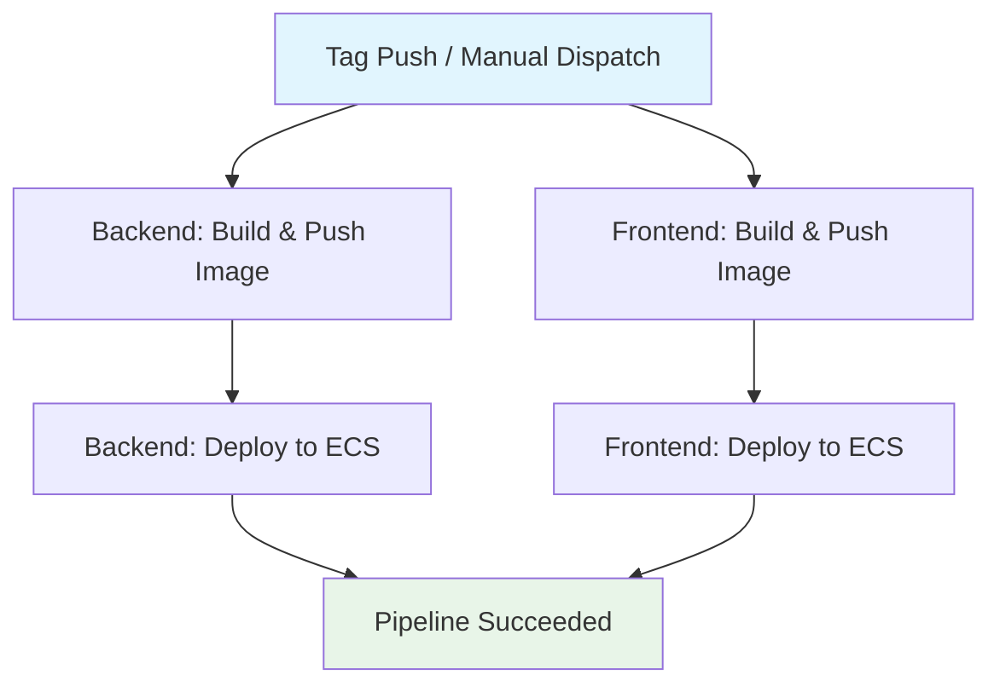

## Workflow Overview

**Purpose**: Build, package, and deploy fullstack frontend and backend containerized applications to Amazon ECS upon git tag releases.
**Trigger Events**: Push events matching tag patterns (`*`), with optional manual triggering via `workflow_dispatch`.
**Target Environments**: AWS ECS Cluster (production / staging container workloads).

## Execution Flow Diagram



## Jobs & Dependencies

| Job Name | Purpose | Dependencies | Execution Context |
|---|---|---|---|
| `backend-build-and-push` | Build backend Docker image and push to Amazon ECR | None (runs parallel to frontend build) | `ubuntu-latest` with Docker & AWS CLI |
| `backend-deploy` | Register new task definition and update ECS service | `backend-build-and-push` | `ubuntu-latest` with AWS CLI & jq |
| `frontend-build-and-push` | Build frontend production Docker image and push to Amazon ECR | None (runs parallel to backend build) | `ubuntu-latest` with Docker & AWS CLI |
| `frontend-deploy` | Register new task definition and update ECS service | `frontend-build-and-push` | `ubuntu-latest` with AWS CLI & jq |

## Requirements Matrix

### Functional Requirements

| ID | Requirement | Priority | Acceptance Criteria |
|---|---|---|---|
| REQ-001 | Automated Trigger on Release | High | Pipeline executes on any git tag push (`refs/tags/*`) |
| REQ-002 | Parallel Build Execution | High | Frontend and Backend build jobs execute concurrently |
| REQ-003 | ECR Image Publishing | High | Docker images tagged with commit ref are pushed to respective ECR repositories |
| REQ-004 | Zero-Downtime Deployment | High | ECS services updated with `--force-new-deployment` and verified stable |

### Security Requirements

| ID | Requirement | Implementation Constraint |
|---|---|---|
| SEC-001 | AWS Credential Masking | All AWS keys, account IDs, and secrets injected via GitHub Actions Secrets |
| SEC-002 | Principle of Least Privilege | GITHUB_TOKEN scoped strictly to `contents: read` |
| SEC-003 | Ephemeral Auth Tokens | ECR authentication via temporary login token retrieved at runtime |

### Performance Requirements

| ID | Metric | Target | Measurement Method |
|---|---|---|---|
| PERF-001 | Parallel Execution Duration | < 8 minutes | GitHub Actions total run duration |
| PERF-002 | ECS Service Stability | Stable state reached | `aws ecs wait services-stable` command execution |

## Input/Output Contracts

### Inputs

```yaml
# Environment Variables & Context Expressions
AWS_REGION: ${{ secrets.AWS_REGION }}
IMAGE_NAME_BE: ${{ secrets.AWS_ACCOUNT_NUMBER }}.dkr.ecr.${{ secrets.AWS_REGION }}.amazonaws.com/${{ secrets.CI_PROJECT_BE_NAME }}:${{ github.ref_name }}
IMAGE_NAME_FE: ${{ secrets.AWS_ACCOUNT_NUMBER }}.dkr.ecr.${{ secrets.AWS_REGION }}.amazonaws.com/${{ secrets.CI_PROJECT_FE_NAME }}:${{ github.ref_name }}

# Repository Triggers
tags: ['*']
workflow_dispatch: {}
```

### Outputs

```yaml
# Build Artifacts Published to ECR
backend_image: "${AWS_ACCOUNT_NUMBER}.dkr.ecr.${AWS_REGION}.amazonaws.com/${CI_PROJECT_BE_NAME}:${REF}"
frontend_image: "${AWS_ACCOUNT_NUMBER}.dkr.ecr.${AWS_REGION}.amazonaws.com/${CI_PROJECT_FE_NAME}:${REF}"

# Deployed ECS Task Definition Revisions
backend_task_revision: "arn:aws:ecs:${REGION}:${ACCOUNT}:task-definition/${TASK_NAME_BE}:${REVISION}"
frontend_task_revision: "arn:aws:ecs:${REGION}:${ACCOUNT}:task-definition/${TASK_NAME_FE}:${REVISION}"
```

### Secrets & Variables

| Type | Name | Purpose | Scope |
|---|---|---|---|
| Secret | `AWS_ACCESS_KEY_ID` | AWS IAM Access Key for authentication | Repository |
| Secret | `AWS_SECRET_ACCESS_KEY` | AWS IAM Secret Access Key | Repository |
| Secret | `AWS_REGION` | AWS Region (e.g., `ap-southeast-1`, `us-east-1`) | Repository |
| Secret | `AWS_ACCOUNT_NUMBER` | AWS 12-digit Account Number | Repository |
| Secret | `CI_PROJECT_BE_NAME` | ECR repository name for Backend | Repository |
| Secret | `CI_PROJECT_FE_NAME` | ECR repository name for Frontend | Repository |
| Secret | `TASK_NAME_BE` | ECS Task Definition family name for Backend | Repository |
| Secret | `TASK_NAME_FE` | ECS Task Definition family name for Frontend | Repository |
| Secret | `CLUSTER_NAME` | Amazon ECS Cluster name | Repository |
| Secret | `SERVICE_NAME_BE` | ECS Service name for Backend | Repository |
| Secret | `SERVICE_NAME_FE` | ECS Service name for Frontend | Repository |

## Execution Constraints

### Runtime Constraints

- **Timeout**: Default GitHub Actions timeout (360 minutes, typically completes in 3-6 minutes).
- **Concurrency**: Parallel build stages with serialized branch/tag execution if enabled.
- **Resource Limits**: Standard GitHub-hosted `ubuntu-latest` runner (2-core CPU, 7GB RAM, 14GB SSD).

### Environmental Constraints

- **Runner Requirements**: `ubuntu-latest` with Docker Engine, AWS CLI, `jq`, and `bash`.
- **Network Access**: Outbound HTTPS connectivity to AWS API endpoints (`*.amazonaws.com`) and GitHub.
- **Permissions**: `contents: read` repository permission.

## Error Handling Strategy

| Error Type | Response | Recovery Action |
|---|---|---|
| AWS Credential Failure | Fail fast at credential configuration step | Inspect IAM user permissions and secret values |
| Docker Build Failure | Fail job, abort subsequent deploy job | Inspect Dockerfile and build context logs |
| ECR Push Failure | Fail job, abort deploy job | Verify ECR repository existence and push permissions |
| Deployment Failure | Fail job, notify pipeline error | Inspect ECS task crash logs and rollback task definition |

## Quality Gates

### Gate Definitions

| Gate | Criteria | Bypass Conditions |
|---|---|---|
| Container Build | Clean Docker build exit code (0) | None |
| Service Rollout | ECS service reaches steady state (`services-stable`) | None |

## Monitoring & Observability

### Key Metrics

- **Success Rate**: Target > 99% for release tags.
- **Execution Time**: Target < 8 minutes end-to-end.
- **ECS Stability Status**: Tracked via `aws ecs wait services-stable`.

### Alerting

| Condition | Severity | Notification Target |
|---|---|---|
| Workflow Run Failure | High | GitHub Notification / Email to commit author |
| ECS Rollout Timeout | High | Workflow timeout error log in GitHub Actions run |

## Integration Points

### External Systems

| System | Integration Type | Data Exchange | SLA Requirements |
|---|---|---|---|
| AWS ECR | Container Registry API | Docker image layer pushes via Docker CLI & ECR helper | High availability |
| AWS ECS | Container Orchestration API | Task definition registration & service update | High availability |

## Compliance & Governance

### Audit Requirements

- **Execution Logs**: Retained according to GitHub Actions repository retention policy (default 90 days).
- **Traceability**: Container images immutably tagged with Git ref (`${{ github.ref_name }}`).

## Validation Criteria

- **VLD-001**: Pushing a git tag triggers the workflow automatically.
- **VLD-002**: Backend and Frontend images build and push to Amazon ECR with correct repository URIs and tags.
- **VLD-003**: New task definition revisions are created with the updated image URIs.
- **VLD-004**: ECS services deploy the new revisions and stabilize successfully.

## Change Management

### Update Process

1. **Specification Update**: Modify this specification when architecture or variables change.
2. **Review & Approval**: Review pull requests modifying `.github/workflows/`.
3. **Implementation**: Test changes in a sandbox or branch with `workflow_dispatch`.
4. **Validation**: Validate deployment on staging ECS cluster before production tag release.
